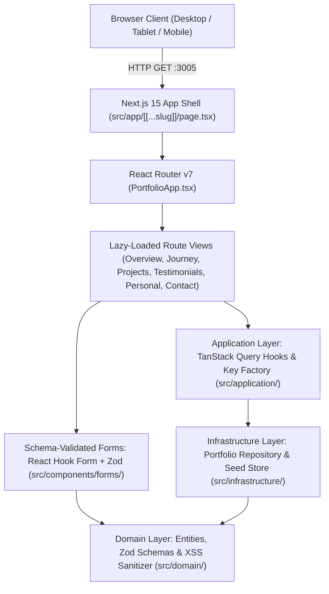

# System Architecture — Personal Webpage & Portfolio

## 1. High-Level Architecture

The **Personal Webpage** (`lumenconsultancyae/personal-webpage`) is a standalone Next.js 15 & React 19 application structured around clean layered frontend boundaries (`domain`, `infrastructure`, `application`, `components`, `routes`). It runs inside a multi-stage production Node 20 Alpine container orchestrated by `personal_docs/docker-compose.yml`.

---

## 2. Layered Module Boundaries (`personal-webpage/src/`)

| Layer | Directory | Responsibility & Inward Dependency Rule |
| :--- | :--- | :--- |
| **Domain** | `src/domain/` | Pure TypeScript interfaces (`models.ts`), shared `zod` validation schemas, and XSS sanitizer (`schemas.ts`). Imports nothing outward. |
| **Infrastructure** | `src/infrastructure/` | In-memory + `localStorage` data repository (`portfolioApi.ts`) and curated career/project seed datasets (`seedData.ts`, `seedCollections.ts`). Depends only on `src/domain/`. |
| **Application** | `src/application/` | Deterministic TanStack Query Key Factory (`queryKeys.ts`) and query/mutation hooks with optimistic updates and rollback (`usePortfolioQueries.ts`). Depends on `domain` and `infrastructure`. |
| **UI Primitives & Forms** | `src/components/ui/`, `src/components/forms/` | Reusable WAI-ARIA primitives (`AppShell.tsx`, `ToastProvider.tsx`, `ConfirmDialog.tsx`, `CommandPalette.tsx`, `PaginationControls.tsx`, `ErrorBoundary.tsx`) and `react-hook-form` panels (`ProjectFormPanel.tsx`, `TestimonialFormPanel.tsx`, `ContactInquiryForm.tsx`). |
| **Declarative Routes** | `src/routes/` | Code-split route views (`OverviewRoute.tsx`, `JourneyRoute.tsx`, `ProjectsRoute.tsx`, `TestimonialsRoute.tsx`, `PersonalRoute.tsx`, `ContactRoute.tsx`) synchronizing URL search parameters via `useSearchParams`. |

---

## 3. Verification & Testing Architecture

1. **In-Process Unit & Component Tests (`personal-webpage/src/__tests__/`)**:
   - Executed via **Vitest** (`npm run test:coverage`) with `@testing-library/react` and `@vitest/coverage-v8`.
   - Verifies Zod validation schemas, XSS sanitization, zero native browser dialogs (`alert`/`confirm`/`prompt`), `< 500` lines per file, TanStack Query optimistic mutations & error rollbacks, WAI-ARIA primitives, and React Router URL search-param synchronization.
2. **End-to-End BDD Browser Acceptance Suite (`personal_docs/tests/bdd/`)**:
   - Executed via **Behave** + headless **Chromium WebDriver** (`bash scripts/run_bdd_e2e.sh`).
   - Strictly separated into declarative Gherkin features (`features/portfolio_ux.feature`), reusable step definitions (`steps/portfolio_steps.py`), and a driver-encapsulated Page Object (`pages/portfolio_page.py`).
