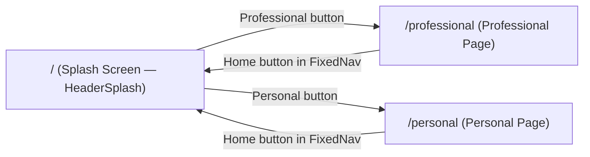

# Architecture Overview (`personal-webpage`)

`personal-webpage` is a clean, low-density Next.js 15 & React 19 application that strictly separates the **Professional** portfolio from the **Personal** page so visitors are never overwhelmed with information.

## Route & Component Structure

1. **Splash Screen (`/`, `src/app/page.tsx` & `src/components/HeaderSplash.tsx`)**:
   - Displays the hero greeting, animated role typewriter, avatar (`/profile-hi.png`), and two buttons: **Professional** and **Personal**.
2. **Professional Page (`/professional`, `src/app/professional/page.tsx`)**:
   - Uses `PageSectionsView` (`type="professional"`, cyan-to-blue gradient) and right-hand floating dot navigation (`FixedNav`) across 4 focused sections:
     - `ProfessionalHighlights` (`#professionalHighlights`) + `Contact`
     - `Journey` (`#journey`) — interactive timeline expanding one role at a time
     - `Testimonials` (`#testimonials`) — spotlight testimonial carousel & technology icons
     - `Projects` (`#projects`) — clean project cards
3. **Personal Page (`/personal`, `src/app/personal/page.tsx`)**:
   - Uses `PageSectionsView` (`type="personal"`, purple-to-fuchsia gradient) and right-hand floating dot navigation (`FixedNav`) across 5 focused sections:
     - `PersonalHighlights` (`#aboutme`)
     - `Traveling` (`#traveling`)
     - `Philosophies` (`#philosophy`)
     - `FunFacts` (`#funfacts`)
     - `Gallery` (`#gallery`)
