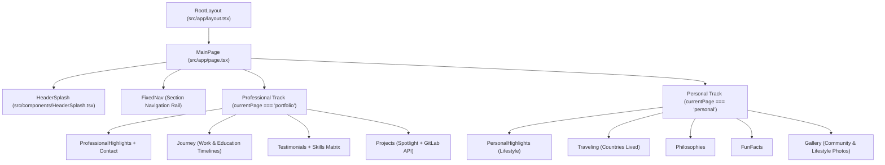

# Technical Architecture — `personal-webpage`

## A. High-Level Architecture

`personal-webpage` is a client-interactive Next.js 15 (App Router) and React 19 single-page portfolio application styled with Tailwind CSS v4, Framer Motion 12, and Material UI (MUI v7). It renders a full-viewport (`100vh`) snap-scrolling experience that transitions between an initial landing hero (`HeaderSplash`) and two distinct content tracks (**Professional** and **Personal**), synchronized bidirectionally with URL hash fragments and an IntersectionObserver-driven floating navigation rail (`FixedNav`).



---

## B. Phase-by-Phase Technical Breakdown

### 1. Initialization & URL Hash Synchronization (`src/app/page.tsx`)
- On mount and on `window` `hashchange` events, `MainPage` inspects `window.location.hash`.
- It iterates through the `pages` dictionary (`portfolio` and `personal` section arrays) to check whether any section's `id` matches the active hash:
  - **Match found**: Sets `currentPage` to the corresponding track key (`"portfolio"` or `"personal"`), updates the router hash via `router.push(#<targetId>)`, and schedules a `requestAnimationFrame` callback to smoothly scroll the target DOM element into view.
  - **Empty or unrecognized hash**: Resets `currentPage` to `""`, sliding the `HeaderSplash` hero banner back into the viewport (`y: 0`).

### 2. Viewport Observation & Floating Navigation (`FixedNav`)
- When `currentPage` is non-empty, `AnimatePresence` mounts the `FixedNav` right-hand navigation rail.
- `FixedNav` attaches an `IntersectionObserver` (`rootMargin: "-40% 0px -40% 0px"`) to all section DOM nodes belonging to the active track.
- Whenever a section intersects the center band of the viewport, `activeId` updates and triggers a 2-second `scrolling` indicator that reveals the active section's text label alongside its enlarged navigation dot.

### 3. Dynamic External Repository Hydration (`src/components/Projects.tsx`)
- Renders curated spotlight project cards (`Interactive Desktop & Stocks Platform`, `RGApps & GamePlan Platform`, `DDDCompiler`, `CodingGame Algorithms`) immediately on initial render.
- In a client `useEffect` hook, queries `https://gitlab.com/api/v4/users/wilsonr990/projects?simple=true&order_by=last_activity_at`.
- Deduplicates returned repositories against `spotlightProjects` by normalizing `web_url` to lowercase before appending additional public repositories to the grid.
- If the network request fails or returns a non-200 status, the component logs the error and preserves the curated spotlight cards without UI disruption.

---

## C. Runtime State & Payload Structures

### Section Definition Schema (`src/app/page.tsx`)

```json
{
  "id": "professionalHighlights",
  "label": "Highlights",
  "title": "Professional Highlights",
  "subtitle": "My CV"
}
```

### Timeline Item Schema (`src/components/Journey.tsx`)

```json
{
  "title": "Senior Data Engineer",
  "company": "Cybersecurity Company (NDA)",
  "location": "Dubai, UAE",
  "duration": "Oct 2023 – Present",
  "details": "Led end-to-end ML inference pipelines (Triton Inference Server, PyTorch, Whisper) optimizing GPU utilization, full-stack internal support tooling, and multi-team Jira sprint roadmaps."
}
```
